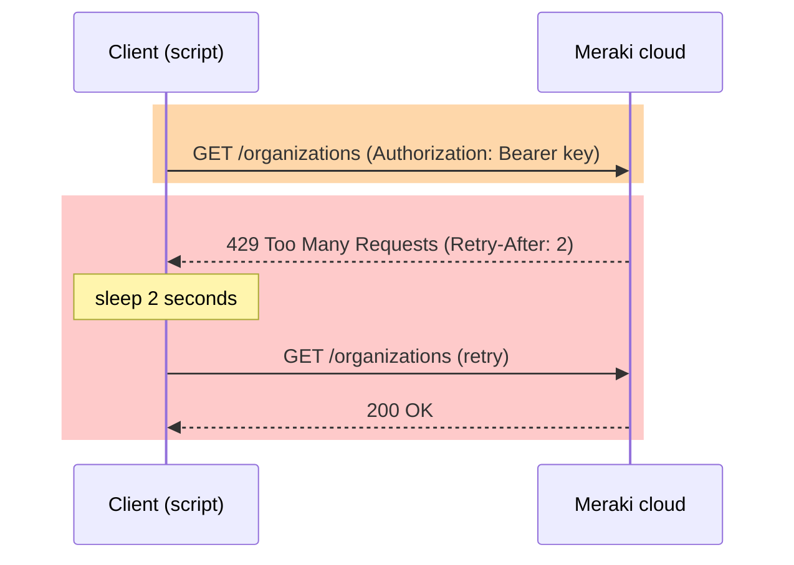
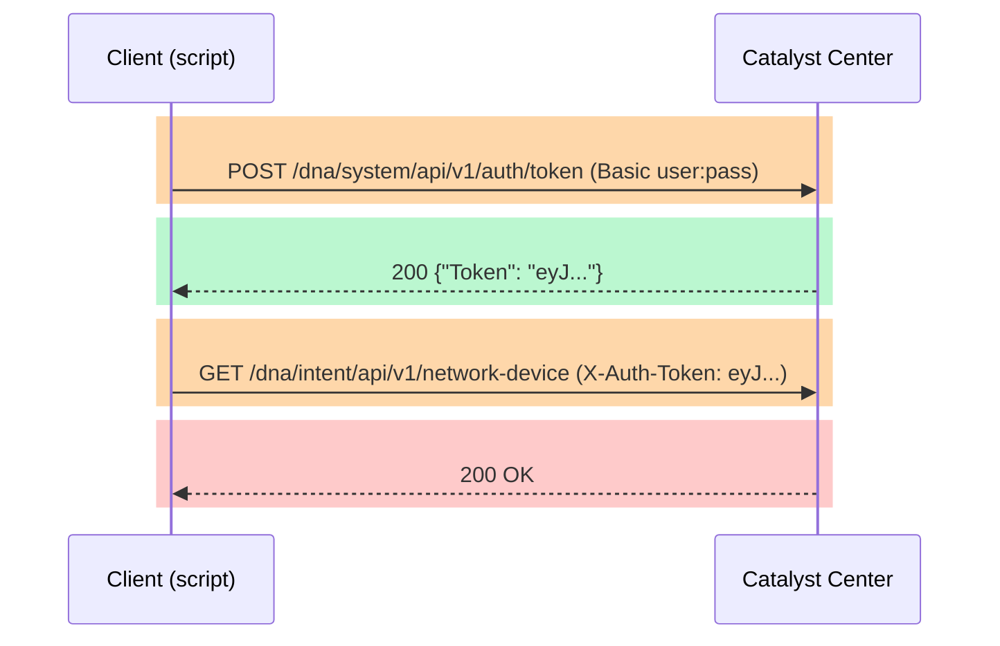
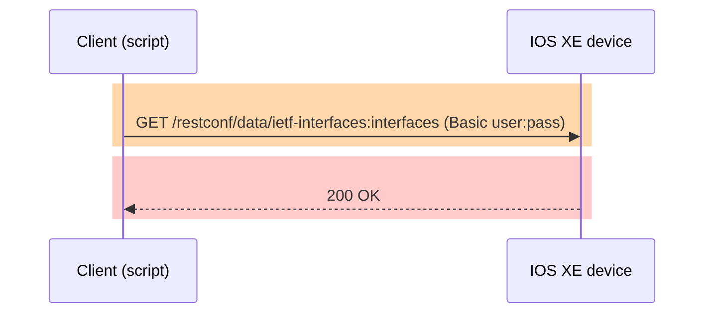
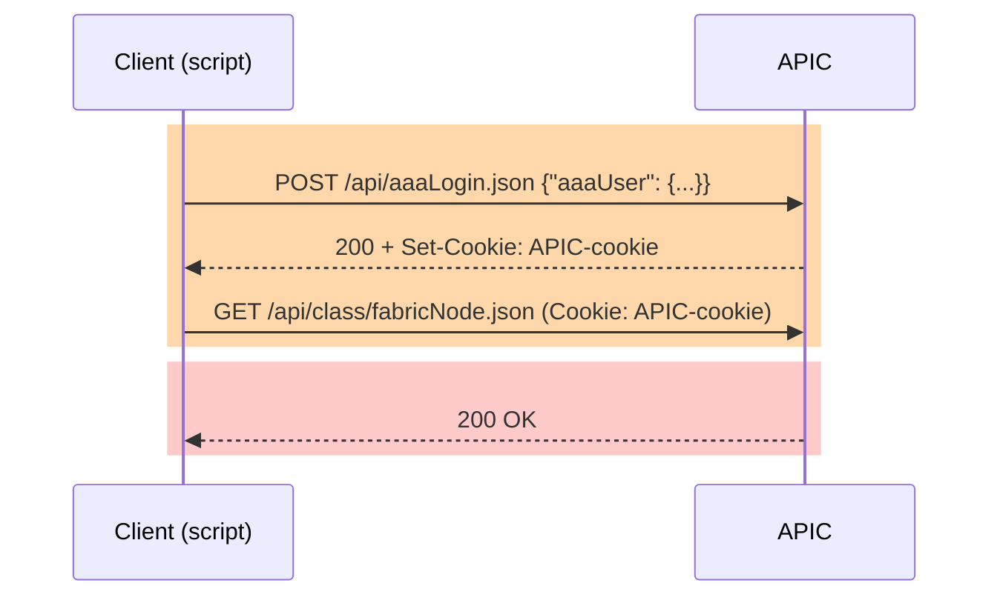
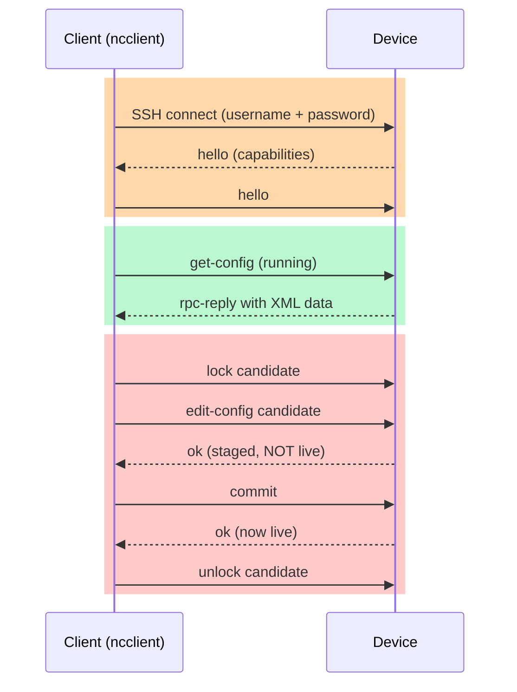

# T51 · Summary examples: REST request/response anatomy and parsing a dictionary: essentials

> Worked examples for blueprint 2.x (REST) and 1.x/5.x (reading Python) · Related: [T45](T45-reading-python-scripts-using-cisco-apis.md), [T50](T50-api-cheatsheet-transport-auth-operations.md)

## 🧭 The big idea
| Example | Shows | Exam cue |
|---|---|---|
| 1. REST request + response | the six parts of one HTTP exchange (raw) | "which part carries X?" |
| 2. Parsing a dictionary | `[]` vs `.get()`, dict holding a list of dicts, looping | "what does this script print?" |
| 3. Reading API code | how to read a script for each platform, line by line | "which platform / what is printed / what is missing?" |

## Example 1 · The six parts of a REST call
One exchange = **3 parts going out** (request) + **3 parts coming back** (response). Each part has its own colour and its own box below.

| Colour | Part | Direction | What it is |
|---|---|---|---|
| 🟥 | **HTTP request** | client → server | method + URL: *what I want to do, and where* |
| 🟧 | **request header** | client → server | metadata about my request: format, login |
| 🟨 | **request payload** | client → server | the data I send |
| 🟩 | **HTTP response** | server → client | status line: *did it work?* |
| 🟦 | **response header** | server → client | metadata about the reply: format, location |
| 🟪 | **response payload** | server → client | the data I get back |

---

### ➡️ REQUEST (client → server)

#### 🟥 1. HTTP request
```text
POST /api/v1/devices HTTP/1.1
```
- `POST` = the action (create). `/api/v1/devices` = where.

#### 🟧 2. request header
```text
Content-Type: application/json
Accept: application/json
Authorization: Bearer abc123
Content-Length: 33
```
- `Content-Type` = format of **my** payload. `Accept` = format I **want back**. `Authorization` = who I am.

#### 🟨 3. request payload
```json
{"name": "sw1", "ip": "10.0.0.1"}
```
- Sits **after** the blank line that ends the headers.

---

### ⬅️ RESPONSE (server → client)

#### 🟩 4. HTTP response
```text
HTTP/1.1 201 Created
```
- `201` = created. This line is the first thing in the reply.

#### 🟦 5. response header
```text
Content-Type: application/json
Location: /api/v1/devices/42
Content-Length: 25
```
- `Location` = where the new object lives.

#### 🟪 6. response payload
```json
{"id": 42, "name": "sw1"}
```
- Also after a blank line. This is the data you parse with `resp.json()`.

---

### 🧩 Put together (raw, in order)
```text
POST /api/v1/devices HTTP/1.1            <- 🟥 HTTP request

Content-Type: application/json           <- 🟧 request header
Accept: application/json                 <- 🟧 request header
Authorization: Bearer abc123             <- 🟧 request header
Content-Length: 33                       <- 🟧 request header

                                         <- (blank line = headers end)
{"name": "sw1", "ip": "10.0.0.1"}        <- 🟨 request payload


HTTP/1.1 201 Created                     <- 🟩 HTTP response

Content-Type: application/json           <- 🟦 response header
Location: /api/v1/devices/42             <- 🟦 response header
Content-Length: 25                       <- 🟦 response header

                                         <- (blank line = headers end)
{"id": 42, "name": "sw1"}                <- 🟪 response payload
```

### 🚩 Exam traps
| Looks like | Actually |
|---|---|
| `Content-Type` and `Accept` are the same | `Content-Type` = format of **my body**; `Accept` = format I **want back** |
| `json=` and `data=` are the same | `json=` serialises the dict **and** sets `Content-Type: application/json`; `data=` does neither |
| `resp.json` | a method: needs `()` |
| `201` means done | `201` = created (check `Location`); `202` = accepted, not finished |
| Headers and body are one thing | headers = metadata (auth, format, length); body = the data |

## Example 2 · Python script parsing a dictionary
A typical API reply is a dict holding a list of dicts. Read it from the outside in.

```python
data = {
    "version": "1.0",
    "devices": [
        {"hostname": "sw1", "status": "up"},
        {"hostname": "sw2", "status": "down"},
    ],
}

print(data["version"])
for device in data["devices"]:
    print(device["hostname"], device["status"])
print(data["devices"][0].get("role", "n/a"))
```

Output:
```text
1.0
sw1 up
sw2 down
n/a
```

| Syntax | Meaning | Trap |
|---|---|---|
| `data["version"]` | value for a key | missing key → `KeyError` |
| `data["devices"]` | the list of dicts | a list, so loop it or index it |
| `for device in data["devices"]` | one dict per loop | looping a dict directly gives **keys** |
| `data["devices"][0]` | first item of the list | index starts at `0` |
| `.get("role", "n/a")` | value or default | missing key → default, **no** error |

## Example 3 · Reading API code, platform by platform
Ask the same 4 questions of every script. Each question has its own icon and number, and the code comments below carry the same tag.

| Tag | What it is for | Question | Look at |
|---|---|---|---|
| 🏷️ **Q1** | **Which product it is** | **Which platform?** | URL path, import line (`requests` / `ncclient`) |
| 🔑 **Q2** | **Authentication method** | **How does it log in?** | the first call, `auth=`, the header that carries the credential |
| 📦 **Q3** | **What data you get back** | **Where is the data?** | the key path after `.json()` |
| 🛡️ **Q4** | **Error management** | **What does success look like?** | status code, `raise_for_status()`, task polling, `commit` |

Snippets are trimmed from the runnable lab scripts in `labs/` (path under each heading). Read each one as: summary, code with tags, the 4 answers, then a diagram of the client/server conversation. Diagram shading shows which question a step answers (login steps orange, error handling red); the Q labels themselves are not steps.

---

### Meraki Dashboard · `labs/T18/meraki_requests.py`
**Summary:**
- Create one `Session` with the key already in its headers.
- Ask for the list of organizations.
- If the server says `429` (slow down), sleep for `Retry-After` seconds, then retry.
- Any other error stops the script.
- Otherwise the reply is a plain list: print the first organization's name.

```python
BASE_URL = "https://api.meraki.com/api/v1"            # 🏷️ Q1: api.meraki.com = Meraki

session = requests.Session()
session.headers.update({
    "Authorization": f"Bearer {API_KEY}",             # 🔑 Q2: static key, sent on every call
    "Accept": "application/json",
})

resp = session.get(BASE_URL + "/organizations")

if resp.status_code == 429:                           # 🛡️ Q4: 429 = too many requests
    time.sleep(int(resp.headers["Retry-After"]))      # 🛡️ Q4: wait as long as the server says
resp.raise_for_status()                               # 🛡️ Q4: any other 4xx/5xx raises an error

orgs = resp.json()                                    # 📦 Q3: a plain JSON list, no wrapper key
print(orgs[0]["name"])
```
| Q | What it is for | Answer | Evidence |
|---|---|---|---|
| 🏷️ Q1 | **Which product it is** | Meraki | `api.meraki.com` (Bearer alone is not enough: Webex uses it too) |
| 🔑 Q2 | **Authentication method** | static API key, no login call | `Authorization: Bearer` in `session.headers` |
| 📦 Q3 | **What data you get back** | the list itself | `resp.json()[0]["name"]` |
| 🛡️ Q4 | **Error management** | `200`; `429` means wait and retry | `status_code == 429`, `Retry-After`, `raise_for_status()` |

**Diagram:**


---

### Catalyst Center (DNA Center) · `labs/T20/catc_inventory.py`
**Summary:**
- Trade the username and password for a token (done once).
- Send that token in the `X-Auth-Token` header on every later call, not the password.
- List the network devices.
- The list sits under the key `"response"`.
- Print each device's name and whether it is reachable.

```python
BASE_URL = "https://sandboxdnac2.cisco.com"

url = f"{BASE_URL}/dna/system/api/v1/auth/token"                   # 🏷️ Q1: /dna/ = Catalyst Center

basic = HTTPBasicAuth(USER, PASSWORD)                              # 🔑 Q2: username + password, once
resp = requests.post(url, auth=basic)

token = resp.json()["Token"]                                       # 📦 Q3: token is in the body, capital T

headers = {"X-Auth-Token": token}                                  # 🔑 Q2: token goes in this header
resp = requests.get(f"{BASE_URL}/dna/intent/api/v1/network-device", headers=headers)

resp.raise_for_status()                                            # 🛡️ Q4: 401 here = bad or expired token

for dev in resp.json()["response"]:                                # 📦 Q3: list is under "response"
    print(dev["hostname"], dev["reachabilityStatus"])
```
| Q | What it is for | Answer | Evidence |
|---|---|---|---|
| 🏷️ Q1 | **Which product it is** | Catalyst Center | `/dna/system/api/v1/auth/token`, `/dna/intent/api/v1/...` |
| 🔑 Q2 | **Authentication method** | **two steps**: Basic auth gets a token, then `X-Auth-Token` header | `auth=HTTPBasicAuth(...)`, then `headers={"X-Auth-Token": token}` |
| 📦 Q3 | **What data you get back** | token: `["Token"]`; devices: `["response"]` | the two `.json()[...]` keys |
| 🛡️ Q4 | **Error management** | `200`; but a PUT/POST returns a **task**, so poll `GET /task/{id}` until `endTime` | `raise_for_status()`; a write is not done at `200`/`202` |

**Diagram:**


---

### RESTCONF on IOS XE · `labs/T16/restconf_client.py`
**Summary:**
- The URL names a YANG model (`ietf-interfaces`) and the part to read (`interfaces`).
- Send username and password with this one request: RESTCONF has no login step.
- The device returns the interface list under a key that includes the module name.
- Print each interface name.

```python
IFACES = f"https://{HOST}/restconf/data/ietf-interfaces:interfaces"   # 🏷️ Q1: /restconf/data/<module>:<container>
HEADERS = {"Accept": "application/yang-data+json",                    # 🏷️ Q1: yang-data+json = RESTCONF
           "Content-Type": "application/yang-data+json"}

r = requests.get(IFACES, auth=(USER, PASSWORD), headers=HEADERS)      # 🔑 Q2: Basic auth on EVERY call

print(r.status_code)                                                  # 🛡️ Q4: 200 = read ok; 401 = forgot auth=

for i in r.json()["ietf-interfaces:interfaces"]["interface"]:         # 📦 Q3: key = "module:container"
    print(i["name"])
```
| Q | What it is for | Answer | Evidence |
|---|---|---|---|
| 🏷️ Q1 | **Which product it is** | RESTCONF, talking to **one device** | `/restconf/data/ietf-interfaces:interfaces`, `yang-data+json` |
| 🔑 Q2 | **Authentication method** | HTTP Basic on every call, **no token step** | `auth=(USER, PASSWORD)` on the call itself |
| 📦 Q3 | **What data you get back** | under `"ietf-interfaces:interfaces"` → `"interface"` | the key is `module:container` |
| 🛡️ Q4 | **Error management** | GET `200`; PUT create `201`; PUT/PATCH/DELETE update `204` (no body) | `r.status_code` |

**Diagram:**


---

### ACI (APIC) · `labs/T19/aci_tenant_builder.py`
**Summary:**
- Log in by POSTing a JSON body; the `Session` keeps the cookie that comes back.
- Ask for every object of the class `fabricNode` (the switches and controllers).
- Each object is a one-key dict, and the key is the class name.
- Unpack that key in the loop, then read the name from `"attributes"`.

```python
BASE = f"https://{APIC}/api"

body = {"aaaUser": {"attributes": {"name": USER, "pwd": PASSWORD}}}  # 🔑 Q2: credentials in a JSON body

url = f"{BASE}/aaaLogin.json"                                         # 🏷️ Q1: aaaLogin.json = APIC

resp = session.post(url, json=body)                                  # 🔑 Q2: session now holds APIC-cookie

data = session.get(f"{BASE}/class/fabricNode.json").json()           # 🏷️ Q1: fabricNode = ACI class

print(data["totalCount"])                                            # 🛡️ Q4: "0" = no match, still HTTP 200

for mo in data["imdata"]:                                            # 📦 Q3: a list of managed objects
    (cls, body), = mo.items()                                        # 📦 Q3: the one key is the class name
    print(cls, body["attributes"]["name"])                           # 📦 Q3: the fields are under "attributes"
```
| Q | What it is for | Answer | Evidence |
|---|---|---|---|
| 🏷️ Q1 | **Which product it is** | ACI (APIC) | `aaaLogin.json`, `fabricNode`, `uni/` objects (`sys/` would be Nexus NX-API REST) |
| 🔑 Q2 | **Authentication method** | **POST JSON login**, then a **cookie** kept by `session` | `aaaUser` body, `session.post(...)` |
| 📦 Q3 | **What data you get back** | `["imdata"]` → one-key dict (the class) → `["attributes"]` | `(cls, body), = mo.items()` |
| 🛡️ Q4 | **Error management** | `200`; **no results is also `200`** with `totalCount: "0"`, not 404 | `data["totalCount"]` |

**Diagram:**


---

### NETCONF · `labs/T15/netconf_walkthrough.py`
**Summary:**
- Open an SSH session to the device and read the running config (`get_config` is config only; `get` adds live state).
- To change something: lock the candidate datastore, stage the new config, commit, then unlock.
- Without the `commit`, the change sits in the candidate and nothing happens on the device.

```python
from ncclient import manager                                 # 🏷️ Q1: ncclient = NETCONF

port = 830                                                   # 🏷️ Q1: port 830, no URL, no HTTP

creds = dict(username=USER, password=PASSWORD)               # 🔑 Q2: SSH username + password
m = manager.connect(host=HOST, port=port, hostkey_verify=False, **creds)

reply = m.get_config(source="running")                       # 📦 Q3: reply is XML (reply.data_xml)

m.lock(target="candidate")                                   # 🛡️ Q4: step 1, nobody else can edit
m.edit_config(target="candidate", config=XML)                # 🛡️ Q4: step 2, staged only, NOT live
m.commit()                                                   # 🛡️ Q4: step 3, now it is live
m.unlock(target="candidate")                                 # 🛡️ Q4: step 4, release
```
| Q | What it is for | Answer | Evidence |
|---|---|---|---|
| 🏷️ Q1 | **Which product it is** | NETCONF (SSH + XML) | `from ncclient import manager`, `port=830` |
| 🔑 Q2 | **Authentication method** | SSH username and password, at connect time | `manager.connect(username=..., password=...)` |
| 📦 Q3 | **What data you get back** | XML, not JSON | `reply.data_xml` |
| 🛡️ Q4 | **Error management** | `<ok/>` reply, but **only live after `commit`** | the `lock` → `edit_config` → `commit` → `unlock` order |

**Diagram:**


---

### Side by side
| | 🏷️ Q1 Which product it is | 🔑 Q2 Authentication method | 📦 Q3 What data you get back | 🛡️ Q4 Error management |
|---|---|---|---|---|
| Meraki | `api.meraki.com` | `Authorization: Bearer <key>` | plain list | `200`; `429` → `Retry-After` |
| Catalyst Center | `/dna/...` | Basic → token → `X-Auth-Token` | `["response"]` | `200`; writes return a task |
| RESTCONF | `/restconf/data/...` | Basic on every call | `"module:container"` | `200` / `201` / `204` |
| ACI | `aaaLogin.json`, `uni/` | JSON POST → cookie | `["imdata"]` → class → `attributes` | `200`, empty = `totalCount: "0"` |
| NETCONF | `ncclient`, `830` | SSH user + password | XML | `<ok/>`, then `commit` |

### 🚩 Reading traps
| Looks like | Actually |
|---|---|
| `Bearer` means Webex | Meraki and Webex both use it; the host name decides |
| `aaaLogin.json` means ACI | also NX-API REST: `uni/` is ACI, `sys/` is Nexus |
| `200` on a write means done | Catalyst Center returns a task; poll it |
| `["response"]` and `["imdata"]` are interchangeable | `response` = Catalyst Center; `imdata` = ACI / NX-API REST |
| no `auth=` and no token header | the call fails with `401` |
| `edit_config` succeeded, so it is live | needs `commit` on a candidate datastore |
