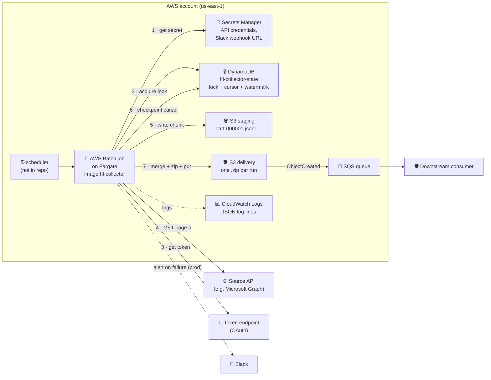
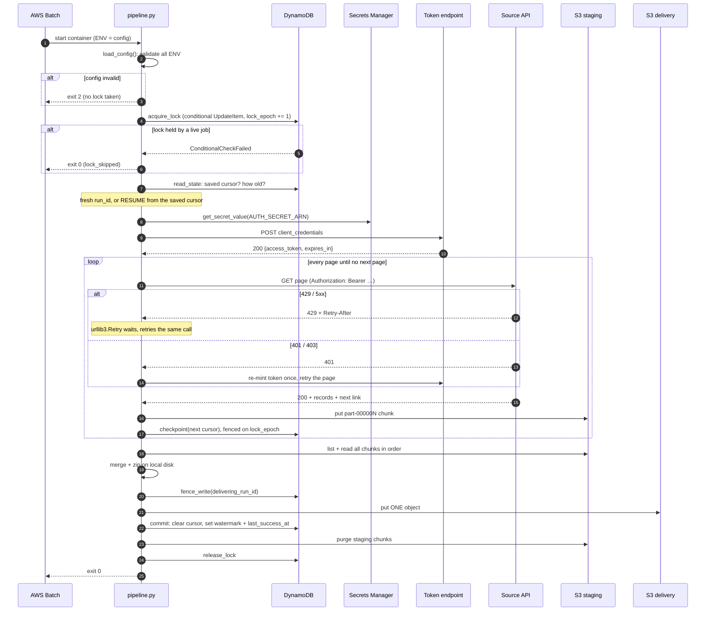

# Case study · `harbourline-api-collector`: a real API → S3 pipeline, read through our CCNAAUTO topics

> **Repo:** `harbourline-api-collector` (a sample / dummy repo; names changed) · **Read at:** `main`, latest commit "feat: add dotenv", 4 commits, 12 Python modules + Dockerfile · **Read on:** 21 Oct 2026
>
> **How to use this:** each section explains one part of the repo in plain English first, then shows the real code with every important line annotated, then links it to the study topic it uses (T06–T47). Section 7 lists what's wrong and how to fix it. Anything marked **✅ verified** was reproduced by running the repo's own logic locally; everything else comes from reading the code.

**Contents**

1. [🧭 The big idea](#1--the-big-idea)
2. [🗺️ The architecture](#2-️-the-architecture)
3. [🔁 One run, end to end](#3--one-run-end-to-end)
4. [📁 Module map](#4--module-map)
5. [🔬 Module by module](#5--module-by-module)
6. [🧠 The design methods used](#6--the-design-methods-used)
7. [❌ What's wrong, and how to fix it](#7--whats-wrong-and-how-to-fix-it)
8. [🛠️ Improvement roadmap](#8-️-improvement-roadmap)
9. [🔗 Topic index: where each study topic appears](#9--topic-index-where-each-study-topic-appears)
10. [✍️ Self-check](#10-️-self-check)

---

## 1. 🧭 The big idea

> 💡 **One generic Python job that copies the full result set of any HTTP API into S3, as exactly one file per run.** Nothing in the code is specific to any one API: the URL, the auth method, the pagination style and the response format are all environment variables. Adding a new data source means writing a new **config**, not new code.

| | Question | The repo's answer | Analogy |
|---|---|---|---|
| 📥 | **What does it fetch?** | every page of one API endpoint (e.g. a device list from Microsoft Graph) | a courier collecting every volume of a multi-volume book |
| 🔖 | **What if it crashes halfway?** | it saved a **bookmark** (the next-page cursor) in DynamoDB after every page, so the next run **resumes** | a sticky note on the last page you finished |
| 🔒 | **What if two copies run at once?** | a **lock** in DynamoDB lets only one run per source; the other exits `0` and does nothing | one key for the meeting room |
| 📦 | **What does it deliver?** | pages are saved to a **staging** bucket, merged and zipped into **one** object, then written to the **delivery** bucket | collecting loose pages in a back room, binding them, then putting one finished book on the shelf |
| 📣 | **Who finds out?** | S3 sends an `ObjectCreated` event to **SQS**, which **the downstream consumer** reads; failures go to **Slack** | the shelf rings a bell when a new book arrives |

- 🎯 **Why it's a good case study:** almost every topic in Domain 2 (APIs) shows up in one place: data formats (T06), REST and status codes (T07), rate limits and paging (T08), auth (T10), `requests` (T11), plus Docker (T27), CI/CD (T28), secrets (T29), Bash exit codes (T31), testing (T32), IaC (T33), webhooks (T43), sequence diagrams (T47) and code review (T46).

---

## 2. 🗺️ The architecture



*Numbers follow one run. The scheduler and the infrastructure itself are not in this repo ("Deploy notes: not automated here").*

| | Component | Role | Study topic |
|---|---|---|---|
| 🐳 | **AWS Batch on Fargate** | runs the container; retries it based on its **exit code** (`evaluateOnExit`) | T26 (public cloud, containers), T27 |
| 🔐 | **Secrets Manager** | holds the API credentials and the Slack webhook URL; the code only knows the secret's **ARN** | T29 (🥇 where secrets should live), T10 |
| 🔒 | **DynamoDB** `hl-collector-state` | one item per source: the **lock**, the **cursor** (bookmark), the **watermark** (last record time) | new concept: see §5.8 |
| 🪣 | **S3 staging bucket** | one object per page, e.g. `staging/graph-devices-dev/<run_id>/part-000003.jsonl` | T26 |
| 🪣 | **S3 delivery bucket** | the one finished object per run; the only bucket with an SQS notification | T43 (event-driven, push not poll) |
| 📨 | **SQS → consumer** | the consumer is told a new object exists, instead of polling the bucket | T43 webhooks vs polling |
| 📣 | **Slack** | the job **sends** a webhook when something fails | T43 (sender side) |
| 📊 | **CloudWatch Logs** | every log line is one JSON object, so it can be searched by field | T29 (mask secrets in logs) |

---

## 3. 🔁 One run, end to end



*This is a T47 sequence diagram: solid arrows are requests, dashed arrows are replies, `alt` boxes are branches, `loop` is the paging loop.*

| Phase | What happens | Why in this order |
|---|---|---|
| 1 🎛️ **Validate** | read and check every ENV variable | fail **before** touching anything: a bad config exits `2` with no lock taken |
| 2 🔒 **Lock** | take the per-source lock in DynamoDB | stops two runs of the same source writing over each other |
| 3 🔖 **Decide** | fresh run, or resume from a saved cursor less than `STATE_CURSOR_MAX_AGE_SEC` (default 24 h) old | resumes cheap crashes; restarts if the bookmark is too old to trust |
| 4 🔐 **Auth** | read the secret, mint a token if needed | credentials are only fetched once the run is sure to happen |
| 5 📄 **Page loop** | fetch → **write chunk** → work out the next page → **checkpoint** | the chunk is safe in S3 **before** the bookmark moves past it (see §5.10) |
| 6 📦 **Deliver** | merge chunks, zip, fenced write, put one object | the consumer only ever sees a complete file |
| 7 ✅ **Commit** | move the watermark, clear the cursor | only after delivery succeeded |
| 8 🧹 **Clean up** | purge staging, release the lock | `finally:` block, so it also runs after most failures |

---

## 4. 📁 Module map

| | File | Lines | Responsibility | Main topics |
|---|---|---|---|---|
| 🎼 | `pipeline.py` | 302 | orchestration: lock → paginate → deliver → commit → release; `main()` | T02, T31, T47 |
| 🚦 | `errors.py` | 39 | exit codes 0–5 + exception classes | T31, T02 |
| 📝 | `observe.py` | 43 | one-line JSON logs + secret redaction | T29 |
| 🎛️ | `config.py` | 314 | `Config` frozen dataclass, ENV loading + validation, `resolve_path()` | T02, T06 |
| 🔐 | `auth.py` | 126 | six `AUTH_MODE`s, secret field remap, token refresh | **T10**, T11, T29 |
| 🌐 | `httpclient.py` | 75 | `requests.Session` + `urllib3.Retry`, one page fetch | **T11**, **T08**, T07 |
| 📄 | `pagination.py` | 92 | five `PAGE_MODE`s + stuck-cursor guard | **T08** |
| 🧾 | `records.py` | 80 | parse JSON / XML / CSV, serialise one page | **T06** |
| 🪣 | `storage.py` | 124 | S3 key layout, purge, streaming merge + zip | T26 |
| 🔒 | `state.py` | 157 | DynamoDB lock, fencing token, heartbeat, checkpoint, commit | new: distributed locking |
| 📣 | `alerts.py` | 34 | Slack webhook, fire-and-forget, prod only | T43 |
| 🧪 | `test_pipeline.py` | 699 | local `http.server` stub API + `moto`, 12 tests | **T32** |
| 🐳 | `Dockerfile`, `.dockerignore` | 23, 8 | one image for every source | **T27** |
| 📚 | `README.md` | 147 | install, run, test, build/push, deploy notes | T27, T28, T33 |

- Only **two** runtime dependencies: `boto3` (AWS) and `requests` (HTTP). `moto` is test-only (`requirements-dev.txt`).
- The README calls `AGENTS.md`, `docs/PRD.md` and `docs/CONVENTIONS.md` the "source of truth", and the code comments cite them constantly (`PRD §6.6`, `invariant §6.10`). Those files are **git-ignored**, so they aren't in the repo (see issue 7.8).

---

## 5. 🔬 Module by module

### 5.1 🎛️ `config.py`: all behaviour comes from environment variables

> 💡 **Config-driven ("12-factor") design.** The same container image runs for every source; only the ENV variables on each Batch job definition differ. The README says there are 62 variables.

```python
@dataclass(frozen=True)          # frozen = read-only after creation: no code can change config mid-run
class Config:
    src_id: str                  # field names mirror the ENV var, lowercased (SRC_ID → src_id)
    auth_mode: str
    page_mode: str
    ...

_VALID = {                                        # allow-lists: anything else is a config error
    "auth_mode": {"none", "bearer", "api_key_header", "basic",
                  "oauth2_client_credentials", "token_exchange"},
    "api_response_format": {"json", "xml", "csv"},
    "page_mode": {"none", "next_url", "cursor_param", "offset_limit",
                  "page_number", "link_header"},
    ...
}

def _env(name, default=None):
    v = os.environ.get(name)                       # .get(): missing → None (T10: quiet, not KeyError)
    return v if v not in (None, "") else default   # empty string counts as "not set"
```

- **Typed helpers** turn strings into the right type and fail clearly: `_env_int` → `"HTTP_TIMEOUT_SEC must be an integer, got 'abc'"`, `_env_bool` accepts only `"true"`/`"false"`, `_env_json` requires a JSON **object** (T06: `json.loads` + an `isinstance(parsed, dict)` check).
- **Cross-field rules** in `_validate()`: e.g. `PAGE_MODE=offset_limit` needs `PAGE_OFFSET_PARAM`, `PAGE_LIMIT_PARAM` and `PAGE_SIZE`; CSV can't use `next_url`; `PAGE_MAX` must be ≥ 1 (so a loop can never run forever); `S3_DELIVERY_PATH` must match `^[a-z0-9-]+(/[a-z0-9-]+){2}$` (e.g. `acme/inventory/devices`).
- **Every failure is `ConfigError` → exit `2`**, raised before any lock or network call. That's **fail fast**: a typo costs one second, not a half-finished run.

**`resolve_path()`: the T06 "navigate parsed data" rule as a function**

```python
def resolve_path(obj, path):
    """Dotted path into nested dicts. '$' means the object itself."""
    if path == "$":
        return obj
    cur = obj
    for part in path.split("."):                          # "data.items" → ["data", "items"]
        if not isinstance(cur, dict) or part not in cur:  # only dicts: no list indexes like [0]
            return None                                   # missing → None, never KeyError
        cur = cur[part]
    return cur
```

- Used for three things: where the records are (`REC_PATH`), where the next-page link is (`PAGE_NEXT_URL_PATH`), and where the token is in the token reply (`AUTH_TOKEN_JSON_PATH`, default `access_token`).
- T06 link: "curly brace = key". This walker only handles keys, never `[0]` indexes, and it **splits on every dot**. That causes bug 7.1.

| ✅ Good | ⚠️ Watch |
|---|---|
| frozen dataclass, allow-lists, typed parsing, cross-field checks, exit 2 before any side effect | `resolve_path` can't address a key that contains a dot (`@odata.nextLink`) or a list element |

### 5.2 🚦 `errors.py`: exit codes are a contract with AWS Batch

> 💡 **The exit code is the only thing Batch sees.** Its `retryStrategy` with `evaluateOnExit` decides "retry" or "give up" from that number, so every failure type maps to exactly one code. Same idea as T31: `0` = success, anything else = a specific failure.

| Exit | Class | Meaning | Batch should… |
|---|---|---|---|
| `0` | (none) | success, **or** lock held by another live job (`lock_skipped`) | do nothing |
| `1` | `PipelineError`, `PageMaxError`, any unexpected exception | **transient**: network blip, `PAGE_MAX` reached (state kept, next run resumes) | **retry** |
| `2` | `ConfigError` | bad ENV | stop: a human must fix config |
| `3` | `AuthError` | token endpoint failed, or still 401/403 after one refresh | stop: credentials or permissions |
| `4` | `DataContractError`, `CursorStuckError` | the API's reply isn't what the config says (bad JSON, wrong path, non-429 4xx, stuck cursor) | stop: config or API changed |
| `5` | `LockSupersededError` | another job took this source's lock mid-run | stop: the other job owns it now |

```python
class PipelineError(Exception):
    exit_code = EXIT_TRANSIENT          # default for the base class: 1

class AuthError(PipelineError):
    exit_code = EXIT_AUTH               # 3: subclasses just override one class attribute (T02 inheritance)

class CursorStuckError(DataContractError):
    pass                                # inherits exit_code 4
```

- In `pipeline.run()`, one `except PipelineError as e: return e.exit_code` handles all of them: **polymorphism** (T02), with each class carrying its own code.
- ⚠️ Exit `0` on a lock conflict means a **leaked lock looks like healthy, successful runs that deliver nothing**. The README knows this and makes a CloudWatch alarm ("no successful run in N hours") mandatory.

### 5.3 📝 `observe.py`: structured logs with secrets masked

```python
_REDACT_VALUES: set[str] = set()          # filled at runtime with every secret value fetched
_REDACT_KEYS = {"authorization"}          # header names whose value is always masked

def redact(obj):
    if isinstance(obj, str):
        for secret in _REDACT_VALUES:
            if secret and secret in obj:
                obj = obj.replace(secret, "***")   # mask the value wherever it appears
        return obj
    if isinstance(obj, dict):                       # walk dicts and lists recursively
        ...

def emit(event, cfg=None, **fields):
    rec = {"event": event}                          # e.g. "page_fetched", "token_refreshed", "run_failed"
    if cfg is not None:
        rec["src_id"] = cfg.src_id
    rec.update(fields)
    log.info(json.dumps(redact(rec), default=str))  # ONE line of JSON per event
```

| | Practice | Why | Topic |
|---|---|---|---|
| 📏 | one JSON object per line | CloudWatch Logs Insights can filter by field (`event = "run_failed"`) instead of grepping text | T28 monitoring |
| 🙈 | mask by **value**, not just by key | a token leaked inside an error message or URL is still masked | T29 "mask secrets in logs" |
| ➕ | secrets registered the moment they're fetched (`auth.py`, `alerts.py`) | nothing can be logged before it's registered | T29 |

- ✅ The test `test_auth_bearer_remap_and_redaction` checks that `"SEKRET-TOKEN"` never appears in captured logs.

### 5.4 🔐 `auth.py`: six auth modes in one class

> 💡 **This is T10 in production.** The three blueprint methods (Basic, custom token, API key) are all here, plus OAuth 2.0 client credentials. The credential itself comes from **Secrets Manager**, never from code or ENV values.

**The six modes:**

| | `AUTH_MODE` | T10 method | What goes on the wire | Secret fields needed |
|---|---|---|---|---|
| ⛔ | `none` | no auth | nothing | none |
| 🎫 | `bearer` | static token | `Authorization: Bearer <token>` | `token` |
| 🔑 | `api_key_header` | **API key** | `<AUTH_APIKEY_HEADER_NAME>: <key>` (e.g. `X-Cisco-Meraki-API-Key`-style) | `api_key` |
| 🪪 | `basic` | **Basic** | `Authorization: Basic <base64(user:pass)>` | `username`, `password` |
| 🚗 | `oauth2_client_credentials` | **OAuth 2.0** (machine-to-machine) | POST client ID + secret to the token URL → `Bearer <access_token>` | `client_id`, `client_secret` |
| 🔁 | `token_exchange` | **custom token** (log in once, then send the token) | POST to a login URL with Basic, Bearer or body creds → `Bearer <token>` | `client_id` + `client_secret`, **or** `token` |

**Secret field remap: one code path for many vendors**

```python
def load_secret(self):
    raw = self.secrets.get_secret_value(SecretId=self.cfg.auth_secret_arn)   # boto3 → Secrets Manager
    payload = json.loads(raw["SecretString"])        # the secret is a JSON string (T06)
    fmap = self.cfg.auth_secret_field_map            # e.g. {"client_id": "api_key", "client_secret": "api_secret"}
    self.creds = {
        canonical: payload[fmap.get(canonical, canonical)]   # the vendor's key name → the code's canonical name
        for canonical in _canonical_fields(self.cfg, payload, fmap)
    }
    for v in self.creds.values():
        _REDACT_VALUES.add(v)                        # mask every credential from now on
```

- Each vendor's secret may use different key names (the test uses a CrowdStrike-style `{"key_secrets": "…"}`). `AUTH_SECRET_FIELD_MAP` translates them, so the code always reads `self.creds["token"]`.

**Token refresh: proactive and reactive**

```python
def ensure_token(self, now):
    """Proactive: mint if missing or within skew of expiry."""
    if self.token and now < self.token_expires_at - self.cfg.auth_token_refresh_skew_sec:
        return                                   # still valid for more than 60 s (default skew): keep it
    self._mint(now)                              # otherwise get a new one BEFORE it expires

def force_refresh(self, now):
    """Reactive refresh after a 401/403."""      # called by httpclient.fetch_page
    ...
    self._mint(now)
```

| ⏰ Proactive | 🚨 Reactive |
|---|---|
| before **every** request: is the token within 60 s of `expires_in`? → mint a new one | the API said 401/403 anyway (clock skew, revoked token) → mint once and retry that page |
| avoids most 401s | safety net; a second 401/403 → `AuthError`, exit 3 |

```python
def _mint(self, now):
    if cfg.auth_mode == "oauth2_client_credentials":
        data = {"grant_type": "client_credentials",           # OAuth grant for machine-to-machine
                "client_id": self.creds["client_id"],
                "client_secret": self.creds["client_secret"]}
    ...
    resp = self.session.post(cfg.auth_token_url, data=data or None,   # data= → form-encoded (T11: not json=)
                             headers=headers or None, timeout=cfg.http_timeout_sec)
    self.session.auth = None                                  # undo the Basic auth set for token_exchange
    ...
    token = resolve_path(body, cfg.auth_token_json_path)      # default "access_token"
    _REDACT_VALUES.add(token)                                 # the new token is masked too
    ttl = resolve_path(body, cfg.auth_token_expiry_json_path) # default "expires_in"
    self.token_expires_at = now + (int(ttl) if ttl else cfg.auth_token_ttl_sec)  # fallback 300 s
```

- **OAuth client credentials** (no user, no browser, no `code`) is the machine-to-machine grant. It's the OAuth flow you'd use for a script; T10's authorization-code flow is the one where an app acts **for a user**.
- `apply()` adds the header to each request. For `basic` it builds the header by hand with `base64.b64encode`, which is exactly what `requests`' `auth=(user, pw)` does for you (T10/T11).

### 5.5 🌐 `httpclient.py`: one Session, automatic retries, refresh on 401

```python
def build_session(cfg):
    retry = Retry(
        total=cfg.http_max_retries,                     # default 5 attempts
        backoff_factor=cfg.http_backoff_factor,          # default 1.0 → waits grow exponentially
        status_forcelist=[429, 500, 502, 503, 504],     # T08: rate limit + server errors are retryable
        allowed_methods=["GET", "POST"],                 # ⚠️ POST included (see issue 7.10)
        respect_retry_after_header=True,                 # T08: honour 429 Retry-After
        raise_on_status=False,                           # after the last retry, return the response
    )
    adapter = HTTPAdapter(max_retries=retry)             # the adapter does the retrying
    s = requests.Session()                               # T11: reuse connections, shared settings
    s.mount("http://", adapter)
    s.mount("https://", adapter)
    return s
```

> 🎯 **T08 in one object:** a `429` with `Retry-After: 1` is retried automatically after 1 s; `500/502/503/504` are retried with exponential backoff. `test_retry_after_429` proves it (✅ in the repo's tests).

**`fetch_page()`: how each status code is handled**

```python
for attempt in range(2):                         # the original call + one retry after a token refresh
    auth.ensure_token(now)                       # proactive refresh
    headers = dict(cfg.api_headers_extra)
    auth.apply(headers)                          # add Authorization / API key header
    ...
    resp = session.request(cfg.api_http_method, url,
                           params=query or None,                  # T11: params= builds ?a=1&b=2
                           json=body if body is not None else None,  # T11: json= serialises + sets Content-Type
                           headers=headers,
                           timeout=cfg.http_timeout_sec)          # T11: ALWAYS a timeout (default 30 s)
    if resp.status_code in (401, 403):
        if attempt == 0:
            auth.force_refresh(time.time())      # reactive refresh, then loop once more
            continue
        raise AuthError(...)                     # exit 3
    if 400 <= resp.status_code < 500:
        raise DataContractError(...)             # exit 4: other 4xx are "your request is wrong"
    resp.raise_for_status()                      # a 5xx that survived every retry
    return resp
```

| Status | What happens | T07 / T08 / T10 rule |
|---|---|---|
| `200` | return the page | success |
| `401` | refresh the token, retry once | ✅ T10: 401 = "who are you?" → re-authenticate |
| `403` | **also** refresh and retry once | ⚠️ T10: 403 = "I know you, but no" → a new token won't help (issue 7.9) |
| `429` | `Retry` sleeps `Retry-After`, retries up to 5× | ✅ T08 |
| `429` after all retries | falls into the `4xx` branch → **exit 4** | ⚠️ should be transient, exit 1 (issue 7.4) |
| other `4xx` | `DataContractError`, exit 4 | ✅ T07: 4xx = client's fault, retrying won't help |
| `5xx` | retried with backoff, then `raise_for_status()` → exit 1 | ✅ T07/T08: server's fault, retry |

### 5.6 📄 `pagination.py`: five paging styles behind one loop

> 💡 **T08's three styles, plus two variants.** `derive_next()` looks at the current reply and returns either the next request ("descriptor") or `None` = finished.

| | `PAGE_MODE` | How the next page is found | Stops when | T08 style |
|---|---|---|---|---|
| 🔗 | `next_url` | a full URL in the body (`PAGE_NEXT_URL_PATH`, e.g. Graph's `@odata.nextLink`) | no URL in the reply | cursor (server-built link) |
| 🎟️ | `cursor_param` | an opaque token in the body, sent back as a query or body param | no token | **cursor** |
| ✉️ | `link_header` | the HTTP `Link: <…>; rel="next"` header | no `rel="next"` | cursor via `Link` header (Meraki-style) |
| 🔢 | `offset_limit` | `offset += page_size` | a page returns **fewer** than `PAGE_SIZE` records | **offset/limit** |
| 📖 | `page_number` | `page += 1` | a page returns fewer than `PAGE_SIZE` records | **page number** |

```python
def parse_link_header(link):
    """Return the rel="next" URL from an HTTP Link header, or None."""
    for part in link.split(","):                 # Link: <url1>; rel="next", <url2>; rel="last"
        segs = part.split(";")
        url = segs[0].strip().strip("<>")        # strip the angle brackets around the URL
        for attr in segs[1:]:
            if attr.strip() == 'rel="next"':
                return url
    return None
```

**Two safety guards:**

| | Guard | What it catches | Result |
|---|---|---|---|
| 🔁 | **stuck cursor**: the "next" link equals the current one | an API bug that would loop forever on the same page | `CursorStuckError`, exit 4 (✅ `test_cursor_stuck`) |
| 🧱 | **`PAGE_MAX`** (required, ≥ 1) | a dataset far bigger than expected | `PageMaxError`, exit **1**: state is kept, the **next** run resumes |

- `PAGE_MAX` as exit 1 is a deliberate design choice: a huge dataset can be fetched across several runs, each resuming from the last bookmark.

### 5.7 🧾 `records.py`: JSON, XML and CSV in, chunks out

> 💡 **T06 for real:** the same pipeline handles all three formats, using exactly the parsers we studied.

```python
def parse_records(cfg, resp):
    if fmt == "json":
        try:
            body = resp.json()                       # T06/T11: same as json.loads(resp.text)
        except ValueError:                           # T06: JSONDecodeError is a ValueError
            raise DataContractError(...)
        recs = resolve_path(body, cfg.rec_path)      # e.g. REC_PATH=value for Microsoft Graph
        if not isinstance(recs, list):               # T06: check the level is a list before looping
            raise DataContractError(...)
        return recs
    if fmt == "xml":
        root = ET.fromstring(resp.content)           # T06: bytes in → root Element
        return root.findall(f".//{cfg.rec_xml_record_element}")   # T06: .// = any depth
    if fmt == "csv":
        reader = csv.reader(io.StringIO(text), delimiter=cfg.rec_csv_delimiter)
        rows = list(reader)
        return rows[1:] if cfg.rec_csv_header_enabled else rows    # drop the header row
```

**What each page becomes in staging (`chunk_bytes`):**

| Source format | Staging chunk | Merge result (`storage.py`) |
|---|---|---|
| JSON | one record per line (JSON Lines), `json.dumps(r, separators=(",", ":"))` | `[r1,r2,…]` array, or `.jsonl` |
| XML | `ET.tostring(element)` for each record, concatenated | wrapped in `<REC_XML_ROOT_ELEMENT>…</…>` (default `records`) |
| CSV | rows re-written with `csv.writer`; header only on page 1 | chunks concatenated |

- **Watermark** (`max_watermark`): for incremental fetches, it tracks the highest `INC_FIELD` value seen (e.g. `updated_at`). JSON only. See issues 7.3 and 7.5: it is tracked but never actually used to filter, and it's compared as text.

### 5.8 🔒 `state.py`: lock, fencing token, heartbeat, checkpoint (new concept)

This file uses ideas that aren't in the CCNAAUTO blueprint but appear in any serious automation job. From first principles:

> 💡 **The problem:** Batch might start two copies of the same source (a retry overlaps a slow run, or two schedules fire). Two writers would corrupt the cursor and deliver twice. You need **mutual exclusion across machines**, with no shared memory, so the lock lives in a database.

**🏢 Analogy: booking a meeting room with numbered tickets.**

| Real world | In the code | DynamoDB attribute |
|---|---|---|
| 🔑 you book the room until 3 pm | **lease lock** with an expiry | `lock_owner`, `lock_expires_at` |
| 🎫 every booking gets the **next ticket number** | **fencing token** | `lock_epoch` (incremented on every acquire) |
| ⏲️ you phone reception every 20 min to extend | **heartbeat** thread | extends `lock_expires_at` |
| 🚪 if you vanish, the booking expires and someone else can take it | lock TTL (default 3600 s) | `lock_expires_at < now` |
| 📋 any change to the room's whiteboard must quote your ticket; reception rejects old tickets | **fenced write** | `ConditionExpression="lock_epoch = :epoch"` |
| 🔖 a note saying where you got to | **checkpoint** | `next_cursor`, `pages_done`, `run_id`, `cursor_saved_at` |
| 🏁 the last finished date | **watermark** | `watermark`, `last_success_at` |

**Acquire = one atomic conditional write:**

```python
resp = ddb.update_item(
    TableName=cfg.state_table,
    Key={"src_id": {"S": cfg.src_id}},                         # one row per source
    ConditionExpression="attribute_not_exists(lock_owner) OR lock_expires_at < :now",
                                                               # free, OR the old lease has expired
    UpdateExpression="SET lock_owner = :job, lock_expires_at = :exp ADD lock_epoch :one",
                                                               # take it AND bump the ticket number
    ...
    ReturnValues="ALL_NEW",
)
return int(resp["Attributes"]["lock_epoch"]["N"])              # my ticket number
# ConditionalCheckFailedException → return None → pipeline exits 0 "lock_skipped"
```

- DynamoDB checks the condition and writes **in one step**, so two jobs can't both win. That atomicity is what makes it a lock.

**Why the ticket number (fencing token) matters:**

| Time | Job A (slow, paused) | Job B | Without fencing | With fencing |
|---|---|---|---|---|
| t0 | takes lock, epoch **1** | | | |
| t1 | freezes (long GC pause, network hang) past the TTL | | | |
| t2 | | lease expired → takes lock, epoch **2** | | |
| t3 | wakes up, writes its checkpoint | | ❌ A overwrites B's cursor | ✅ A's write says `epoch = 1`, DB has 2 → **rejected** → `LockSupersededError`, exit 5 |
| t4 | `finally:` tries to release | | ❌ A deletes **B's** lock | ✅ release is also fenced and skipped; "a superseded job must NOT release" |

- ✅ `test_superseded_cannot_deliver` steals the lock mid-run and checks that A exits 5, delivers nothing, and leaves the thief as owner.

```python
class Heartbeat:                                   # a daemon thread running beside the page loop
    def _run(self):
        while not self._stop.wait(self.cfg.state_heartbeat_interval_sec):   # every 1200 s by default
            self.ddb.update_item(...,
                ConditionExpression="lock_epoch = :epoch AND lock_owner = :job",
                UpdateExpression="SET lock_expires_at = :exp")              # push the expiry forward
            # ConditionalCheckFailed → self.superseded.set(): the main loop checks this flag each page
```

### 5.9 🪣 `storage.py`: staging layout, merge, zip, delivery key

```python
def staging_key(cfg, run_id, page):
    return f"{cfg.s3_staging_prefix}/{cfg.src_id}/{run_id}/part-{page:06d}.{ext}"
    #          staging    / graph-devices-dev / 4f1c…  / part-000003.jsonl
    #                                                    └ zero-padded to 6 digits
```

- **Why zero-pad?** S3 lists keys in **text** order. Without padding, `part-10` sorts before `part-2`. With `part-000002` and `part-000010`, text order equals page order, so the merge can just sort the keys.

| Delivery key mode | Key | Use |
|---|---|---|
| `overwrite` (default) | `delivery/acme/inventory/devices.zip`: same key every run | the consumer only wants "the latest" at a fixed path |
| `unique` | `…/devices/2026/10/21/<run_id>__<epoch>.zip` | keep history, one object per run |

- `merge_and_zip()` reads each chunk in order, writes them into one local file, then zips it into a single entry named after the dataset (`devices.json`). The comment notes Fargate's ephemeral disk (default 20 GB, up to 200 GB) is the size ceiling.

### 5.10 🎼 `pipeline.py`: the order of operations is the whole design

**The page loop, step by step:**

```python
while True:
    resp = fetch_page(...)                                   # 1 · fetch (retries, auth refresh)
    records = parse_records(cfg, resp)
    page += 1
    chunk = chunk_bytes(cfg, resp, records, is_first_chunk=(page == 1))
    s3.put_object(Bucket=cfg.s3_staging_bucket,              # 2 · WRITE CHUNK to S3 first
                  Key=staging_key(cfg, run_id, page), Body=chunk)
    nxt = derive_next(cfg, resp, records, cursor_value, offset, page_num)   # 3 · work out the next page
    checkpoint(cfg, ddb, job_id, epoch, json.dumps(nxt) if nxt else "",     # 4 · THEN move the bookmark
               page, run_id, time.time())                                   #     (fenced on lock_epoch)
    if nxt is None:
        break                                                # no next page: done
    if page >= cfg.page_max:
        raise PageMaxError(...)                              # exit 1, resume next run
```

**Why "write chunk, then checkpoint" and not the other way round:**

| Crash happens… | Write → checkpoint (the repo) | Checkpoint → write (wrong order) |
|---|---|---|
| after fetch, before write | bookmark still at page n → page n refetched ✅ | same ✅ |
| after write, before checkpoint | bookmark still at page n → page n refetched and **overwritten** at the same key (`part-00000n`) ✅ no duplicate | n/a |
| after checkpoint, before write | n/a | ❌ bookmark says page n is done, but it was never saved → **page n silently lost** |

> 🎯 **The rule:** never move the bookmark past data that isn't safely stored. Re-doing a page is harmless (same key, overwritten); skipping one is silent data loss. ✅ `test_resume_after_kill` crashes after page 3 of 10 and checks that all 100 IDs arrive **exactly once**.

**Deliver, then commit, then release:**

| Step | Code | Why here |
|---|---|---|
| 📦 deliver | `_deliver()`: merge → zip → `fence_write(delivering_run_id)` → `put_object` to delivery | the fence just before the put stops a superseded job publishing |
| ✅ commit | `commit()`: clear `next_cursor`, set `watermark`, `last_success_at` | "watermark advances ONLY after delivery succeeds": a failed run can't skip data next time (✅ `test_failed_run_watermark_unchanged`) |
| 🧹 purge | `purge_staging()` | staging is temporary |
| 🔓 release | in `finally:`, only if not superseded | releases even after most errors, so the next run isn't blocked for an hour |

**Other decisions in `run()`:**

- **Fresh vs resume** (`_decide_run`): resume if a cursor exists **and** is younger than `STATE_CURSOR_MAX_AGE_SEC` (24 h); otherwise start fresh with a new `run_id` and purge the old run's orphan chunks (✅ `test_stale_cursor_restarts_fresh`).
- **Resume rejected:** if the first request of a resumed run gets a 4xx (e.g. the saved cursor expired on the API side), fall back to a fresh run once.
- **Zero records:** no delivery, a `warn` alert, but the run still commits (✅ `test_zero_record_skips_delivery`).
- **`main()`** loads `.env` (added in the last commit), configures logging to stdout, builds the clients and returns `run()`'s exit code via `sys.exit(main())` (T02: the `__main__` guard).

### 5.11 📣 `alerts.py`: the job as a webhook sender

```python
def send_alert(cfg, session, secrets, severity, event, text):
    if not should_alert(cfg, severity) or not cfg.alert_slack_secret_arn:
        return                                      # dev runs never alert; below min severity → skip
    try:
        raw = secrets.get_secret_value(SecretId=cfg.alert_slack_secret_arn)
        webhook = json.loads(raw["SecretString"])["webhook_url"]   # the webhook URL IS a secret
        _REDACT_VALUES.add(webhook)                                # so it's masked in logs
        msg = f"[{cfg.src_id}] {event}: {text}"
        session.post(webhook, json={"text": msg}, timeout=cfg.http_timeout_sec)   # Slack incoming webhook
    except Exception as e:                          # "alerting must never fail the run"
        emit("run_failed", cfg, note=f"slack alert failed: {e}", severity="warn")
```

| T43 receiver (what we studied) | This repo (the sender) |
|---|---|
| exposes a public HTTPS URL, verifies the HMAC signature, replies `200` fast | POSTs JSON to someone else's URL; the URL itself is the credential, so it's kept in Secrets Manager |

### 5.12 🐳 `Dockerfile` and `.dockerignore`: T27 line by line

```dockerfile
FROM python:3.13-slim                         # T27: slim official base, smaller attack surface
ENV PYTHONUNBUFFERED=1 \                      # print logs immediately (Batch → CloudWatch sees each line)
    PYTHONDONTWRITEBYTECODE=1                 # no .pyc files in the image
WORKDIR /app
COPY requirements.txt .                       # T27 layer cache: dependencies FIRST…
RUN pip install --no-cache-dir -r requirements.txt   # …so this slow layer only rebuilds when requirements change
COPY *.py ./                                  # …then code (changes often, cheap layer). Only .py files: no .env, no docs
RUN useradd --create-home --uid 10001 pipeline
USER pipeline                                 # T27/T29: run as non-root
ENTRYPOINT ["python", "pipeline.py"]          # T27: exec form, the container IS this program; no CMD args needed
```

- `.dockerignore` keeps `test_pipeline.py`, `requirements-dev.txt`, `docs/`, `*.md`, `.git/` and `.venv/` out of the build context: smaller, faster builds, and test-only code never ships.
- ✅ Every T27 best practice is here: cache-friendly order, non-root user, exec-form `ENTRYPOINT`, slim base, no build tools left in the image.

### 5.13 🧪 `test_pipeline.py`: testing without any network or AWS account

> 💡 **Test doubles (T32 mocking), two kinds at once:** a fake API and a fake AWS.

| Fake | What it replaces | How |
|---|---|---|
| 🌐 `_Stub` | the source API and token endpoint | a real `http.server.HTTPServer` on `127.0.0.1`, port `0` (the OS picks a free port), in a background thread. Each test sets `stub.responder` to decide status, headers and body |
| ☁️ `moto` `@mock_aws` | S3, DynamoDB, Secrets Manager | intercepts every `boto3` call in memory. No AWS account touched |
| 🩹 monkeypatching | a crash at a chosen moment | e.g. replaces `pipeline.checkpoint` with a version that raises after the 3rd call |

**The 12 tests and what each proves:**

| | Test | Proves |
|---|---|---|
| 1 | `test_config_error_before_lock` | bad config → `ConfigError` before anything else |
| 2 | `test_failed_run_watermark_unchanged` | a data-contract failure exits 4 and leaves the watermark alone |
| 3 | `test_resume_after_kill` | crash after page 3 of 10 → the next run resumes; 100 IDs, no duplicates |
| 4 | `test_stale_cursor_restarts_fresh` | an old cursor → fresh run_id, orphan chunks purged |
| 5 | `test_superseded_cannot_deliver` | lock stolen mid-run → exit 5, no delivery, lock not released |
| 6 | `test_cursor_stuck` | the same next URL twice → exit 4 |
| 7 | `test_lock_conflict_exits_zero` | a live lock → exit 0, nothing delivered |
| 8 | `test_retry_after_429` | `429` + `Retry-After: 1` → retried, run succeeds |
| 9 | `test_zero_record_skips_delivery` | no records → no object, `last_success_at` set |
| 10 | `test_auth_bearer_remap_and_redaction` | secret field remap works; token never in logs |
| 11 | `test_xml_format` | XML records merged under `<records>` |
| 12 | `test_csv_format` | header appears exactly once across pages |

- The runner is hand-written: a list `ALL`, a loop with `try/except`, exit `1` if any failed. Tests use bare `assert` (see issue 7.11).

### 5.14 📚 `README.md`: the commands, explained

```bash
aws sso login --profile hl-dev          # log in with SSO; boto3 then finds the creds via its default chain
export AWS_PROFILE=hl-dev
export RUN_MODE=dev                     # dev = logs only, no Slack
export AUTH_MODE=oauth2_client_credentials
export AUTH_SECRET_FIELD_MAP='{"client_id":"api_key","client_secret":"api_secret"}'   # vendor key names → canonical
export PAGE_MODE=next_url
export PAGE_NEXT_URL_PATH='@odata.nextLink'      # ⚠️ see issue 7.1
python pipeline.py
echo "exit code: $?"                    # T31: $? = the last command's exit code
```

```bash
docker build -t $REPO:latest .                                         # T27: build the image
aws ecr get-login-password --region $REGION \
  | docker login --username AWS --password-stdin $ACCOUNT.dkr.ecr.$REGION.amazonaws.com   # T31 pipe: password via stdin, never on the command line
docker tag $REPO:latest $ACCOUNT.dkr.ecr.$REGION.amazonaws.com/$REPO:latest   # add the registry host to the name (T27 image naming)
docker push $ACCOUNT.dkr.ecr.$REGION.amazonaws.com/$REPO:latest
```

```bash
docker run --rm \
  -e AWS_PROFILE=hl-dev ... \                       # config as ENV, one -e per variable
  -v ~/.aws:/home/pipeline/.aws:ro \                # T27 bind mount, read-only: your AWS creds for local testing
  hl-collector:latest
```

- `--password-stdin` keeps the ECR password out of shell history and `ps` output (T29).
- The `:ro` mount means the container can read but never change your credentials.

---

## 6. 🧠 The design methods used

| | Method | Where | Why | Analogy |
|---|---|---|---|---|
| 🎛️ | **Config-driven, one image for everything** | `config.py`, `Dockerfile` | a new source is a new Batch job definition, never new code | one vending machine, different products loaded |
| 🛑 | **Fail fast** | `load_config()` → exit 2 before any lock | errors surface in seconds, with no side effects | checking your passport before driving to the airport |
| 🚦 | **Exit-code contract** | `errors.py` | the scheduler can decide "retry" vs "give up" without parsing logs | traffic-light colours |
| 🔒 | **Lease lock + fencing token** | `state.py` | only one writer per source, even across machines and pauses | numbered room-booking tickets |
| 🔖 | **Checkpoint / resume** | `checkpoint()`, `_decide_run()` | a crash costs one page, not the whole run | a bookmark |
| 📏 | **Write-before-checkpoint ordering** | page loop | re-doing a page is safe; skipping one isn't | save the file before ticking it off |
| 🏗️ | **Stage, then publish** | staging vs delivery buckets | the consumer only ever sees complete files | the back room vs the shop shelf |
| 🎯 | **Exactly one object per run** | `_deliver()` + SQS on delivery only | the consumer gets exactly one notification per run | one parcel, one doorbell |
| 🌊 | **Watermark committed after success** | `commit()` | a failed run never moves "how far we got" | only update the diary after the trip |
| 📝 | **Structured logs + redaction** | `observe.py` | searchable logs that never leak secrets | a redacted court transcript |
| 🧪 | **Test doubles** | `_Stub`, `moto` | full end-to-end tests with no network or account | a flight simulator |
| 🪶 | **Minimal dependencies** | `requirements.txt`: 2 libraries | smaller image, fewer CVEs to patch | packing light |

---

## 7. ❌ What's wrong, and how to fix it

Severity: 🔴 wrong output or data loss · 🟠 reliability or process risk · 🟡 small or style.

### 7.1 🔴 The README's own Microsoft Graph example only ever fetches page 1 · *T06, T08* · ✅ verified

- **What:** the README sets `PAGE_NEXT_URL_PATH='@odata.nextLink'`. `resolve_path()` splits on `.`, so it looks for `body["@odata"]["nextLink"]`. The real key is the literal string `"@odata.nextLink"`.
- **Reproduced** with the repo's own function:

```
resolve_path({"value": [...], "@odata.nextLink": "https://…?$skiptoken=abc"}, "@odata.nextLink")
→ None
```

- **Why it's bad:** `None` means "no next page", so the run stops after page 1, delivers a partial file and exits `0`. This is T08's **first-page-only bug**, with nothing to flag it.
- **Fix:** try the whole path as a literal key first, then fall back to splitting (✅ verified):

```python
def resolve_path(obj, path):
    if path == "$":
        return obj
    if isinstance(obj, dict) and path in obj:     # literal key wins: "@odata.nextLink"
        return obj[path]
    cur = obj
    for part in path.split("."):
        if not isinstance(cur, dict) or part not in cur:
            return None
        cur = cur[part]
    return cur
# resolve_path({"@odata.nextLink": "u2"}, "@odata.nextLink") → 'u2'
# resolve_path({"a": {"b": [1]}}, "a.b")                     → [1]
```

- Add a test that uses Graph's real reply shape.

### 7.2 🔴 Namespaced XML silently returns zero records · *T06* · ✅ verified

- **What:** `root.findall(".//record")` doesn't match `<record>` when the document has a default namespace (T06 sheet 05: the real tag is `{urn:…}record`).

```
ET.fromstring('<feed xmlns="urn:v"><record>…</record><record>…</record></feed>').findall(".//record")
→ []
```

- **Why it's bad:** zero records → `delivery_skipped`, a `warn` alert, exit `0`. The run looks successful and delivers nothing. Many enterprise and SOAP-style APIs return namespaced XML.
- It also breaks the "no transformation" promise: `ET.tostring()` rewrites the record as `<ns0:record xmlns:ns0="urn:v">` (✅ verified).
- **Fix:** match any namespace with `{*}` (Python 3.8+), or add a `REC_XML_NS` setting and use a namespace map:

```python
root.findall(f".//{{*}}{cfg.rec_xml_record_element}")   # → 2 records on the example above (✅ verified)
```

### 7.3 🔴 Incremental fetching never actually filters anything · *T08*

- **What:** `INC_ENABLED`, `INC_PARAM` and `INC_FIELD` exist, and a watermark is tracked and saved. But the value sent to the API is never the watermark:

```python
# httpclient.py
if cfg.inc_enabled and is_fresh_first_page and cfg.inc_param:
    query[cfg.inc_param] = extra_query.get(cfg.inc_param, query.get(cfg.inc_param))
    #                      ^ neither of these is the saved watermark
```

  - `extra_query` never contains `inc_param`, so this sets the param to its own existing value, or `None`. `requests` drops `None` params from the URL (✅ verified: `params={"since": None, "a": 1}` → `?a=1`).
  - `prev_watermark` is passed into `_paginate()` only as the starting value for the max calculation; it never reaches `fetch_page()`.
  - `INC_FORMAT` and `INC_LOOKBACK_SEC` are defined in `config.py` and **used nowhere else**.
- **Why it's bad:** every "incremental" run is a **full pull**: more API calls (rate limits, T08), more data, more cost, while the config suggests otherwise.
- **Fix:** pass the watermark into `fetch_page()`, format it per `INC_FORMAT`, subtract `INC_LOOKBACK_SEC` (to catch late-arriving records), and set `query[cfg.inc_param] = formatted`. Add a test asserting the stub **received** `?updated_after=…`.

### 7.4 🟠 An exhausted 429 is treated as a permanent data error · *T07, T08*

- **What:** `Retry` handles `429` up to 5 times. With `raise_on_status=False`, the final `429` is **returned**, and `fetch_page()` then hits `if 400 <= resp.status_code < 500: raise DataContractError` → **exit 4**. The comment says "429 already handled by Retry", which is only true while retries remain.
- **Why it's bad:** exit 4 means "don't retry" to Batch. A rate limit is the textbook **transient** error (T08); the run should back off and try again later (exit 1).
- **Fix:** check for `429` (and `408`) before the generic 4xx branch and raise a transient `PipelineError` (exit 1).

### 7.5 🟠 The watermark is compared as text, and lost on resume · *T06* · ✅ verified

- **What:** `max_watermark()` keeps `str(val) > str(best)`.

```
epoch values 999, 1000         → max by text = '999'                   ❌
"…09:00:00Z" vs "…09:00:00.5Z" → max by text = '2026-10-01T09:00:00Z'  ❌ ('Z' sorts after '.')
```

- On a **resume**, `prev_watermark` is set to `None`, so the max only covers pages fetched after the crash; the earlier pages' maximum is forgotten.
- **Why it's bad:** once 7.3 is fixed, a wrong watermark means **skipped or repeated records**.
- **Fix:** parse according to `INC_FORMAT` before comparing (`int()` for epoch, `datetime.fromisoformat()` for ISO 8601; ✅ verified it picks `…09:00:00.5Z`), and save the running max in each checkpoint.

### 7.6 🟠 CI is red, has no project config, and nothing is reviewed · *T28, T46, T04*

- **What:**
  - The only pipeline run (#1, 31 Jul) **failed at `build` and `test`** (both `allow_failure: false`). `code_quality` failed; `secret_detection`, `semgrep-sast`, dependency and container scanning were all **skipped**.
  - The repo has **no `.gitlab-ci.yml`**, so those jobs most likely come from a group or compliance template. The job logs weren't available, so the exact failure cause is unknown.
  - The last commit (`feat: add dotenv`, 31 Aug) has **no pipeline at all**.
  - Every commit went straight to `main`: no merge requests, so no review.
- **Why it's bad:** T28's first rule is "main stays green". The security scans that would catch a leaked secret or a vulnerable dependency never ran. T46: unreviewed code is how issues 7.1–7.5 got in.
- **Fix:** add a project `.gitlab-ci.yml` (example in §8), protect `main`, require a merge request with one approval, and make the scans block.

### 7.7 🟠 The artifact is hand-built, `latest`-tagged and unpinned · *T27, T28, T02*

- **What:** the README builds and pushes `hl-collector:latest` from a laptop. `requirements.txt` uses `boto3>=1.34` and `requests>=2.31`.
- **Why it's bad:**
  - T27: `latest` is just the default tag name, not "newest". You can't tell which code is running in Batch, or roll back to a known version.
  - T28: an artifact should be built **once, by the pipeline**, and promoted unchanged. Two builds a week apart can pull different library versions.
- **Fix:** CI builds the image, tags it with the commit SHA (`hl-collector:3f9a1c2e`), and pushes it to ECR. Pin exact versions (`pip freeze > requirements.txt`, or a lock file). Point each Batch job definition at a specific tag; rollback = point it at the previous tag.

### 7.8 🟠 The "source of truth" is git-ignored · *T46, T04*

- **What:** `.gitignore` excludes `docs/`, `AGENTS.md` and `CLAUDE.md`. The README calls `docs/PRD.md` and `AGENTS.md` the source of truth, and nearly every docstring cites them (`PRD §6.6`, `invariant §6.10`).
- **Why it's bad:** a reviewer or new teammate can't check the code against its own spec; the README links are dead; the "why" behind each invariant exists only on someone's laptop.
- **Fix:** commit `docs/PRD.md` and `docs/CONVENTIONS.md` (ignore only genuinely personal files), or move the invariants into the README and docstrings.

### 7.9 🟡 403 is treated like an expired token · *T10*

- **What:** `fetch_page()` refreshes the token on **401 or 403**.
- **Why:** T10: 401 = "who are you?" (missing or expired credential → a new token fixes it); 403 = "I know you, but no" (wrong scope or role → a new token for the same client won't help). It's capped at one retry, so it's harmless, just a wasted token call and a misleading `token_refreshed` log.
- **Fix:** refresh on 401 only; on 403, fail fast with an `AuthError` saying "check the app registration's permissions / scope".

### 7.10 🟡 Other issues, each tied to a topic

| | Issue | Why it matters | Topic | Fix |
|---|---|---|---|---|
| 🔑 | If the token POST **raises** (timeout, DNS), `self.session.auth = None` never runs. The Slack alert then goes through the **same session**, sending `Authorization: Basic <client_id:secret>` to Slack. (From reading the code; not run.) | a credential could leave the account; it applies to `token_exchange` with `AUTH_TOKEN_REQUEST_MODE=basic` | T10, T11, T29 | pass `auth=(id, secret)` on the `post()` call itself, or use `try/finally` |
| 🔁 | `Retry(allowed_methods=["GET", "POST"])` | POST isn't idempotent (T07): a retried POST could create something twice | T07 | fine if the API's POST is a read-only search; document that assumption |
| 🎲 | the docstring says "honours Retry-After, jitter", but no jitter is configured (urllib3's `backoff_jitter` defaults to 0) | many failed jobs retry in lockstep | T08 | set `backoff_jitter` |
| 📣 | the Slack text includes up to 500 characters of the API error body and **isn't passed through `redact()`** | API error bodies can contain PII or echoed request data | T29, T43 | `msg = redact(msg)`; don't forward raw response bodies |
| 🛡️ | `ET.fromstring()` on XML from external APIs | T06 exam-sim gap: untrusted XML → `defusedxml` (XXE, entity bombs) | T06 | `from defusedxml.ElementTree import fromstring` |
| 🧾 | "raw passthrough, never re-encode" isn't true: JSON is re-serialised (`ensure_ascii=True` turns `陈大文` into `\u9648\u5927\u6587`, ✅ verified), CSV is re-quoted, XML gets `ns0:` prefixes | consumers may expect the original bytes | T06 | write `resp.content` slices, or at least `ensure_ascii=False`; fix the docs if re-encoding is acceptable |
| 📄 | `offset_limit` / `page_number` stop when a page has **fewer than `PAGE_SIZE`** records | if the API silently caps page size (e.g. asks 500, gets 100), the run stops after page 1 | T08 | stop on an empty page, or on a total-count / `hasMore` field |
| 📊 | CSV assumes **every** page repeats the header and drops row 1 of each page | if the API sends the header only on page 1, the first data row of pages 2+ is lost | T06 | only strip the header on page 1, or compare row 1 to the saved header |
| 💾 | `_deliver()` does `Body=f.read()`: the whole zip in memory, despite "No merge step holds the full dataset in memory". A single `PutObject` is capped at 5 GB | big datasets will crash or fail | T26 | `s3.upload_file(path, bucket, key)`: streams, and switches to multipart automatically |
| 🧪 | tests use bare `assert` with a hand-written runner | `python -O` **removes** asserts, so tests silently pass; no discovery, no per-test isolation | T32 | `unittest.TestCase` (standard library, no new dependency) with `self.assertEqual(...)` |
| 🏗️ | DynamoDB, both buckets, the SQS notification, Batch job definitions, networking and the mandatory alarm are all created by hand | not reproducible, not reviewable, drift between environments | T33 | Terraform (or CloudFormation) in this repo or a sibling infra repo |
| 🧹 | `.DS_Store` committed; the `.env` loader keeps quotes (`KEY="x"` → value `"x"` with the quote marks); `path.replace("/", "/")` in `pagination.py` does nothing; `run_succeeded` is logged twice per run | noise a reviewer would catch | T04, T46 | add `.DS_Store` to `.gitignore` and remove it; strip quotes; delete dead code |

---

## 8. 🛠️ Improvement roadmap

| Priority | Change | Fixes | Effort |
|---|---|---|---|
| 1️⃣ | literal-key-first `resolve_path` + a Graph-shaped test | 7.1 | small |
| 2️⃣ | namespace-aware XML `findall("{*}…")` + a namespaced test | 7.2 | small |
| 3️⃣ | wire the watermark into the request, typed comparison, save it in each checkpoint | 7.3, 7.5 | medium |
| 4️⃣ | `429` after retries → exit 1; 403 → no token refresh | 7.4, 7.9 | small |
| 5️⃣ | `.gitlab-ci.yml` + protected `main` + merge requests | 7.6 | small |
| 6️⃣ | CI-built, SHA-tagged image; pinned dependencies | 7.7 | small |
| 7️⃣ | commit `docs/` | 7.8 | trivial |
| 8️⃣ | per-call `auth=`, redact alerts, `upload_file`, `defusedxml`, `unittest` | 7.10 | medium |
| 9️⃣ | Terraform for the AWS resources | 7.10 (IaC) | large |

**A starting `.gitlab-ci.yml`** (illustrative, not run; adjust image names and runner tags):

```yaml
stages: [lint, test, build, scan]

default:
  image: python:3.13-slim

lint:
  stage: lint
  script:
    - pip install --no-cache-dir ruff
    - ruff check .                                  # T28: cheapest checks first

test:
  stage: test
  script:
    - pip install --no-cache-dir -r requirements-dev.txt
    - python test_pipeline.py                       # exit 1 on any failure → pipeline stops

build:
  stage: build
  image: docker:27
  services: [docker:27-dind]
  script:
    - docker build --tag "$CI_REGISTRY_IMAGE:$CI_COMMIT_SHORT_SHA" .     # T28: build once, tag with the commit
    - docker login --username "$CI_REGISTRY_USER" --password-stdin "$CI_REGISTRY" <<< "$CI_REGISTRY_PASSWORD"
    - docker push "$CI_REGISTRY_IMAGE:$CI_COMMIT_SHORT_SHA"
  rules:
    - if: $CI_COMMIT_BRANCH == $CI_DEFAULT_BRANCH

include:
  - template: Jobs/Secret-Detection.gitlab-ci.yml
  - template: Jobs/SAST.gitlab-ci.yml
  - template: Jobs/Dependency-Scanning.gitlab-ci.yml
```

- Then set **Settings → Repository → Protected branches** for `main` (no direct push) and **Merge request approvals** (1 approver). That's T46's review gate.

---

## 9. 🔗 Topic index: where each study topic appears

| Topic | In this repo |
|---|---|
| **T02** Python structure | modules by responsibility, `@dataclass(frozen=True)`, exception class hierarchy, `if __name__ == "__main__"` |
| **T04** Git | 4 commits straight to `main`, no MRs; `.gitignore` hides the spec; `.DS_Store` committed |
| **T06** data formats | `resp.json()`, `ET.fromstring` + `findall(".//…")`, `csv.reader`, `resolve_path`, JSON Lines; bugs 7.1, 7.2, `ensure_ascii` |
| **T07** REST + status codes | 4xx = client error (no retry) vs 5xx = server error (retry); POST idempotency |
| **T08** API constraints | `429` + `Retry-After`, exponential backoff, 5 pagination styles, `PAGE_MAX`, stuck-cursor guard, resume from a bookmark; bugs 7.3, 7.4 |
| **T09** API styles | REST + JSON over HTTPS; one long-running job ≈ async from the consumer's side (SQS tells it when the file is ready) |
| **T10** auth | Basic, Bearer, API key, OAuth client credentials, custom token exchange; token refresh; 401 vs 403 (7.9) |
| **T11** `requests` | `Session`, `HTTPAdapter` + `Retry`, `params=`, `json=` vs `data=`, `timeout=`, `raise_for_status()` |
| **T26** deployment | public cloud (AWS), containers on Fargate, Batch, object storage |
| **T27** Docker | slim base, layer-cache order, non-root `USER`, exec-form `ENTRYPOINT`, `.dockerignore`, `-e`, `-v …:ro`, ECR tag + push |
| **T28** CI/CD | a failed pipeline, missing project CI, hand-built `latest` artifact (7.6, 7.7) |
| **T29** secrets | Secrets Manager ARNs, redaction by value, `--password-stdin`, read-only credential mount |
| **T31** Bash | exit codes as a contract, `echo $?`, `export`, pipes |
| **T32** testing | `http.server` stub, `moto`, monkeypatched crashes, 12 behaviour tests; bare `assert` (7.10) |
| **T33** IaC | none yet: every AWS resource is manual |
| **T43** webhooks | Slack incoming webhook (sender); S3 → SQS events instead of polling |
| **T46** code review | the issues in §7 are what a review would catch; the spec reviewers need is git-ignored |
| **T47** sequence diagrams | §3 is the run as a sequence diagram: `alt` for branches, `loop` for paging |

---

## 10. ✍️ Self-check

<details><summary>Q1. Why does the job write the S3 chunk <b>before</b> saving the checkpoint?</summary>So the bookmark never moves past data that isn't stored. If it crashes between the two, the page is refetched and overwritten at the same key, which is harmless. The other order would silently lose a page.</details>
<details><summary>Q2. Job A pauses, its lease expires, and Job B takes the lock. What stops A from overwriting B's cursor when it wakes up?</summary>The fencing token. Every write is conditional on <code>lock_epoch = A's epoch</code>; B's acquire bumped it, so A's write is rejected, A raises <code>LockSupersededError</code> and exits 5 without releasing B's lock.</details>
<details><summary>Q3. Why does a lock conflict exit <code>0</code>, and what's the risk?</summary>Another live job is already doing the work, so it's not a failure and Batch shouldn't retry. The risk: a leaked lock makes every run "succeed" while delivering nothing, which is why a "no successful run in N hours" alarm is mandatory.</details>
<details><summary>Q4. Which T10 auth method is <code>oauth2_client_credentials</code>, and how is it different from the authorization-code flow?</summary>OAuth 2.0 for machine-to-machine: the job POSTs its own client ID and secret to the token endpoint and gets a Bearer token. There's no user, browser or <code>code</code>; the authorization-code flow is for an app acting on behalf of a user.</details>
<details><summary>Q5. With <code>PAGE_NEXT_URL_PATH='@odata.nextLink'</code>, why does the run stop after page 1?</summary><code>resolve_path</code> splits on dots and looks for <code>body["@odata"]["nextLink"]</code>; the real key is the literal <code>"@odata.nextLink"</code>, so it returns <code>None</code>, which means "no next page".</details>
<details><summary>Q6. A source keeps returning 429 after all 5 retries. Which exit code does the job return, and which should it?</summary>It returns 4 (data contract, "don't retry"), because the final 429 falls into the generic 4xx branch. It should return 1 (transient), since rate limiting is temporary.</details>
<details><summary>Q7. Name three Dockerfile practices here that match T27.</summary>Any three of: requirements copied and installed before the code (layer cache), non-root <code>USER</code>, exec-form <code>ENTRYPOINT</code>, slim base image, <code>.dockerignore</code> excluding tests and docs, <code>PYTHONUNBUFFERED=1</code> for immediate logs.</details>
<details><summary>Q8. Why is <code>hl-collector:latest</code> a weak artifact, and what's the fix?</summary><code>latest</code> is only the default tag name, so you can't tell which code is running or roll back. Have CI build once, tag with the commit SHA, push to ECR, and point Batch at that exact tag; also pin the Python dependencies.</details>
<details><summary>Q9. How do the tests run with no network and no AWS account?</summary>A real <code>http.server</code> on 127.0.0.1 plays the API (each test sets its responses), and <code>moto</code>'s <code>@mock_aws</code> fakes S3, DynamoDB and Secrets Manager in memory. Crashes are simulated by monkeypatching <code>pipeline.checkpoint</code>.</details>
<details><summary>Q10. What's one T29 practice the repo gets right and one it misses?</summary>Right: secrets come from Secrets Manager by ARN and are masked by value in every log line. Missed: the Slack alert text isn't redacted and can include raw API error bodies; and a failed token POST can leave Basic credentials on the shared session.</details>
